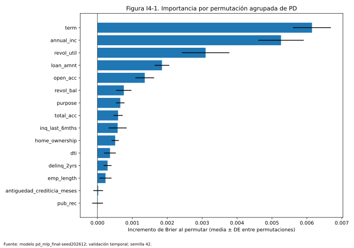

# Integrante 4: scorecard, interpretación y aplicación

## Integración real del 27 de octubre de 2026

Rama: `INTEGRANTE-4`. Se conecta el checkpoint `pd_mlp_final.pt` publicado por
el integrante 2 en `8beb684`, semilla 202612, con su `pd_preprocessor.joblib`
y `pd_feature_names.json`. La app carga pesos existentes en CPU y aplica sigmoid
a los logits; no entrena ni selecciona otra red. La carga exige `positive_class=1`,
reconstruye la arquitectura guardada y verifica que sus 44 entradas coincidan
con las columnas del preprocesador.

Las matrices fueron entregadas por el integrante 1. Los archivos con extensión
`.npz.zip` ya tenían el formato NPZ de SciPy: se conservaron sus bytes con el
nombre `.npz`. Se versionan exactamente los artefactos necesarios para esta app:

- `data/processed/X_train_pd.npz`: 90.347 × 44, referencia del percentil.
- `data/processed/X_validation_pd.npz`: 73.194 × 44, interpretación y verificación.
- `data/processed/y_validation_pd.npy`: 73.194 etiquetas 0/1.
- `artifacts/models/pd_bundle.json`: manifiesto con rutas, modelo y SHA-256.

El preprocesador del modelo final carga con scikit-learn 1.5.2, la versión fijada
por el proyecto. Se contrastaron columnas, categorías, medianas, media, escala
y cantidad de filas con el preprocesador recibido previamente: coinciden a
una tolerancia relativa/absoluta de 1e-12; la mayor diferencia de escala es
7,28e-12. Las matrices tienen valores finitos y codificación one-hot coherente.
La coincidencia de dimensiones no demuestra el orden de filas por sí sola;
la reproducción de las métricas publicadas aporta una comprobación adicional.

## Ejecución sin entrenamiento

```powershell
python -m pip install -r requirements-app.txt
python run_app.py --check
python run_app.py
```

Abrir `http://127.0.0.1:8501`. Para pruebas y figuras usar
`python -m pip install -r requirements-test.txt` y `python -m pytest`.
El arranque y las consultas usan archivos locales, sin descargar datos ni llamar
APIs. El manifiesto se entrega validado; solo es necesario regenerarlo al cambiar
artefactos. Para ello, desde la raíz, con `PYTHONPATH=src`:

```powershell
python -m credit_risk.scorecard.export --model artifacts/models/pd_mlp_final.pt --model-format pd_mlp --model-id pd_mlp_final-seed202612 --training-data "Matrices PD train 2007-2012" --reference-population "90347 creditos etiquetados de train 2007-2012"
python -m credit_risk.scorecard.interpretability --seed 42 --repeats 10 --max-rows 5000
```

En PowerShell se configura la ruta con `$env:PYTHONPATH = "src"`.
`configs/default.yaml` controla puntaje base, odds, PDO y enlaces. El exportador
admite `--model-format pd_mlp` y el formato anterior `joblib`; no deduce el tipo
por el nombre del archivo. La inferencia de PyTorch usa CPU y un hilo por defecto,
configurable con `--inference-threads`. El manifiesto y los archivos se verifican
por contenido para invalidar la caché al cambiar pesos o preprocesamiento.
Los hashes JSON normalizan CRLF a LF para que Git no rompa la verificación
al pasar de Windows a Linux; los artefactos binarios conservan SHA-256 exacto.
Las cargas con una versión incompatible de scikit-learn se rechazan.

## Verificación y resultados reales

La prueba `test_final_model_reproduces_published_validation` calcula las métricas
sobre las 73.194 filas de validación y las compara con
`reports/pd_evaluation/resultados.json`, con tolerancia absoluta 2e-6:
AUC 0,67306135 y Brier 0,16586667. Corresponden al MLP de semilla base, sin una
calibración adicional añadida por la app; no son promedios de 30 modelos.

En la muestra fija de 5.000 filas de validación, semilla 42, el Brier original
es 0.16346065. La Tabla I4-1 muestra las cinco primeras
variables por incremento de Brier al permutar. La Figura I4-1 y los archivos
JSON/CSV contienen las 15 variables, sus repeticiones, hashes e índices muestreados.

**Tabla I4-1. Cinco mayores importancias por permutación agrupada.**
Fuente: elaboración propia con `pd_mlp_final`, validación temporal, semilla 42,
10 permutaciones por variable.

| Variable | Incremento medio de Brier | DE entre permutaciones |
|---|---:|---:|
| `term` | 0.006147 | 0.000543 |
| `annual_inc` | 0.005259 | 0.000651 |
| `revol_util` | 0.003100 | 0.000681 |
| `loan_amnt` | 0.001849 | 0.000208 |
| `open_acc` | 0.001357 | 0.000268 |




El plazo (`term`), el ingreso anual (`annual_inc`) y la utilización rotativa
(`revol_util`) producen las mayores pérdidas de precisión al permutarse en esta
muestra. Esto describe dependencia predictiva; no establece que valores altos
aumenten el riesgo ni que modificar esas variables produzca un efecto causal.
La dirección local se examina con la simulación de una característica de la app.

## Contrato de formulario e inferencia

La entrada contiene las 11 variables numéricas y 4 categóricas definidas por
`data.preprocessing`; la antigüedad crediticia se expresa en meses al originar
el préstamo. Las opciones se obtienen del encoder ajustado y conservan los códigos
originales, incluidos los espacios de `term`. Se exigen campos completos, valores
finitos no negativos y conteos enteros. Los valores iniciales son medianas
(redondeadas en conteos) y categorías de train que el usuario debe revisar.
El formulario no garantiza que un perfil esté dentro de la distribución histórica.

El modelo recibe datos transformados y expone `classes_`, `n_features_in_` y
`predict_proba`; se busca la clase 1 por su etiqueta. El formato `pd_mlp` utiliza
la clase del módulo PD, carga el checkpoint con `weights_only=True` y modo `eval`,
y no modifica pesos. Solo deben cargarse los archivos joblib confiables del equipo.
La referencia del percentil es train, no validación ni test.

## Derivación de la scorecard

Sea `p = P(default_flag = 1 | x)`. Se definen las odds buenas:malas como
`O = (1-p)/p`. Buscamos `S = A + B ln(O)` con dos condiciones:

1. En las odds de referencia `O0`, el puntaje es `S0`.
2. Duplicar las odds buenas:malas suma exactamente `PDO` puntos.

Entonces `S(2O) - S(O) = B ln(2) = PDO`, de donde
`B = PDO / ln(2)` y `A = S0 - B ln(O0)`. Por tanto:

```text
S(p) = S0 + (PDO/ln(2)) · [ln(1-p) - ln(p) - ln(O0)]
p(S) = 1 / [1 + exp((S-A)/B)]
dS/dp = -B / [p(1-p)] < 0
```

Configuración inicial: `S0=600`, `O0=50:1`, `PDO=20`. Son convenciones de
escala, no parámetros estimados ni resultados de desempeño. En `p=1/51`,
el puntaje es 600; en `p=1/101`, es 620. Un puntaje mayor indica menor PD.
`base_score`, `base_good_to_bad_odds` y
`points_to_double_good_to_bad_odds` se cambian en el YAML. Se validan finitud,
odds y PDO positivos. Los cálculos conservan precisión; se redondea solo al mostrar.

Para PD exactamente 0 o 1 se recorta únicamente en la transformación de
puntaje con `epsilon=1e-9`, configurable dentro de `scorecard`. Se evita un
puntaje infinito, sin alterar la PD que se muestra. La inversa de esos extremos
devuelve el límite recortado, no el extremo original. La inversa usa una
formulación numéricamente estable.

Esta es una scorecard continua derivada de la salida del modelo. Para un MLP
no hay puntos aditivos constantes por variable: las interacciones hacen que
el cambio de puntaje dependa del perfil. La app obtiene los puntos de un cambio
como `S(p(x_modificado)) - S(p(x_original))`, pasando ambos perfiles por el
mismo preprocesador y modelo. No se atribuye a cada variable una descomposición
exacta del puntaje total.

## Percentil y escenarios

La referencia es la matriz **train** del mismo paquete PD. Se calcula su PD
en lotes de hasta 2048 filas y se transforma con la misma scorecard de la consulta.
No se acepta `reference_split=test`. Se usa la distribución empírica inclusiva:
`percentil(s) = 100 · número de puntajes de referencia <= s / n`.
Los empates reciben el extremo superior; puede llegar a 0 o 100. Se calcula
con puntajes sin redondear. Cambiar la escala no debe cambiar el percentil,
salvo empates inducidos por el recorte de probabilidades extremas.

El percentil se refiere a los créditos etiquetados seleccionados en train,
no a la población general ni a la población contemporánea. No es PD,
probabilidad de aprobación ni evidencia de calibración.

Cada escenario modifica una variable de la última consulta calculada y
reutiliza modelo, referencia y escala. La app muestra PD, puntaje, percentil
y sus diferencias. Mantener todo lo demás constante permite explorar la
dirección local de la respuesta del modelo. No asegura factibilidad del
escenario ni identifica efectos de una intervención real.

## Interpretabilidad: método, límites y referencias

Se usa importancia por permutación agrupada en validación temporal, con
modelo congelado. Es independiente de la arquitectura y mide cuánto cambia
el error al romper la relación entre una variable y las otras columnas/etiqueta.
Este uso sigue el enfoque de dependencia predictiva por permutación de
Fisher et al. (2019); no implementa su estimación de dependencia de toda
una clase de modelos.

Para cada variable original `j` y repetición `r` se permutan **juntas** todas
sus columnas one-hot con el mismo orden de filas. Así no se crean vectores
categóricos imposibles. Para una muestra fija de validación:
`I_jr = Brier(y, p(X_permutado_jr)) - Brier(y, p(X))`, con
`Brier = media((p-y)^2)`. La métrica responde a errores de probabilidad, por
eso resulta coherente con una app que muestra PD, aunque no reemplaza el
análisis de discriminación o calibración de PD.

El comando guarda JSON con semilla, índices muestreados, repeticiones,
hashes, modelo, Brier original y valores por repetición; también CSV y SVG.
No reajusta ni selecciona el modelo con el conjunto test. La semilla por
defecto se toma de `configs/default.yaml`; `--seed` permite cambiarla.
El límite de 5000 filas controla el tiempo, pero no garantiza dos minutos
con cualquier arquitectura o máquina. Las etiquetas deben corresponder
exactamente al orden de filas de la matriz: el hash no prueba esa alineación.

Una importancia positiva alta indica que el modelo depende de esa variable
para predecir en la muestra. No informa por sí sola si valores altos aumentan
riesgo. Para esa dirección se usa la simulación local del modelo, con el perfil
y el cambio explícitos. No se afirma que el efecto sea monotónico o igual en
todos los clientes. Importancias negativas se conservan y deben investigarse.
La desviación entre permutaciones describe aleatoriedad de la permutación;
no es un intervalo de confianza poblacional ni variabilidad entre 30 redes.

Las variables correlacionadas pueden compartir o esconder importancia,
y permutarlas puede crear combinaciones numéricas fuera de distribución.
Esta limitación está documentada también por scikit-learn (s. f.). Para
conclusiones finales se deben examinar correlaciones, estabilidad temporal,
desempeño del modelo y escenarios plausibles con el equipo de PD/datos.

Referencias APA 7:

- Fisher, A., Rudin, C., & Dominici, F. (2019). All models are wrong, but many
  are useful: Learning a variable’s importance by studying an entire class of
  prediction models simultaneously. *Journal of Machine Learning Research,
  20*(177), 1–81. https://www.jmlr.org/papers/v20/18-760.html
- scikit-learn developers. (s. f.). *Permutation importance with multicollinear
  or correlated features* (versión 1.5.2).
  https://scikit-learn.org/1.5/auto_examples/inspection/plot_permutation_importance_multicollinear.html

## Pendientes para la entrega académica

- Publicar la aplicación en un servidor Python/Streamlit y comprobar su URL.
- El enlace del video promocional está configurado en la app; el reporte se publica en GitHub Pages.
- Repetir la demostración en otra máquina; el ensayo local no sustituye esa prueba.
- Integrar LGD/EAD si el equipo acuerda mostrar pérdida esperada; no bloquea PD/scorecard.
- Mantener en el reporte las limitaciones temporales y de selección del conjunto.

## Uso de IA y verificaciones

La IA ayudó en derivación, implementación, pruebas y documentación. El equipo debe
conservar los prompts literales y revisar el código antes de defenderlo.
Se comprobaron signo, odds, PDO, inversa, empates de percentil, clase positiva,
rechazo de checkpoints incompatibles, hashes, datos reales, métricas publicadas,
consulta y simulación web. Las pruebas sintéticas siguen identificadas como tales.
No se inventaron hallazgos de alucinación para completar el reporte.
