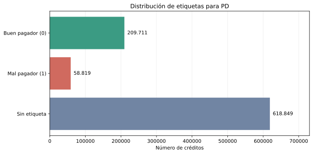
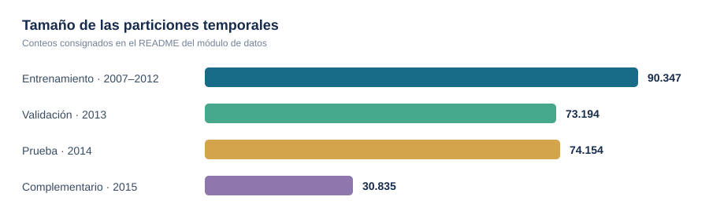
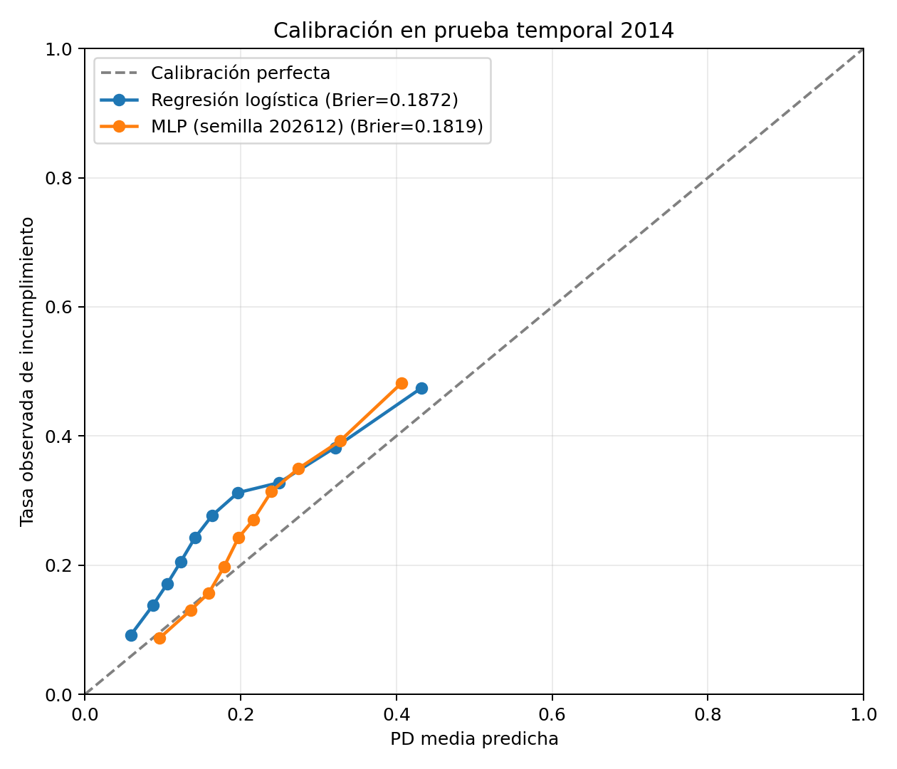
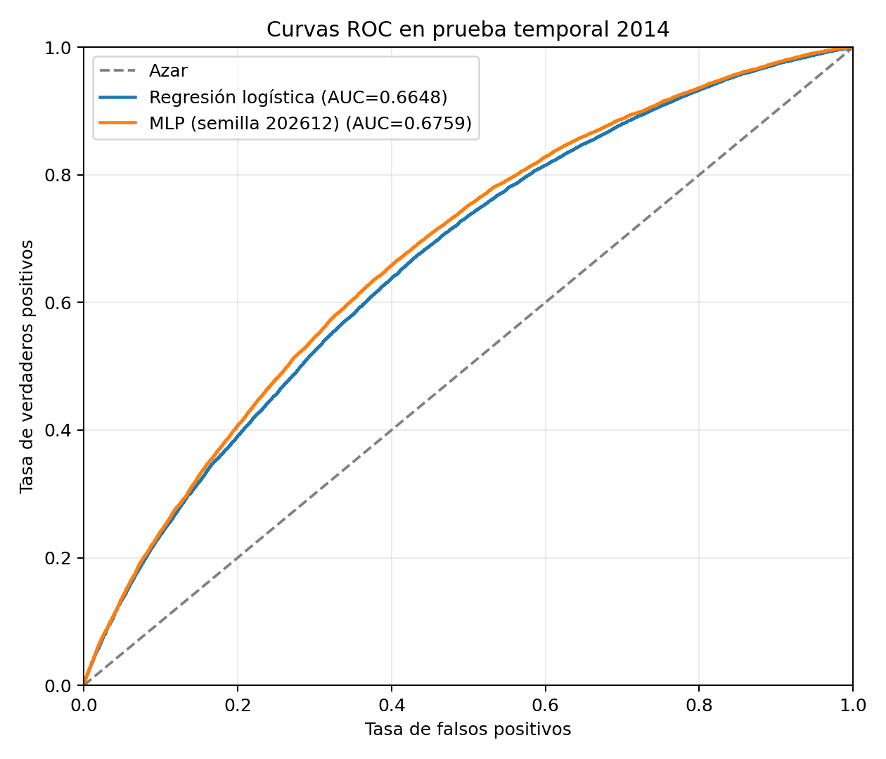
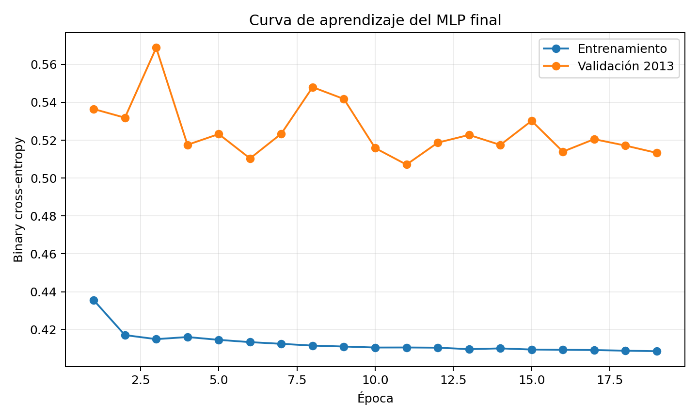
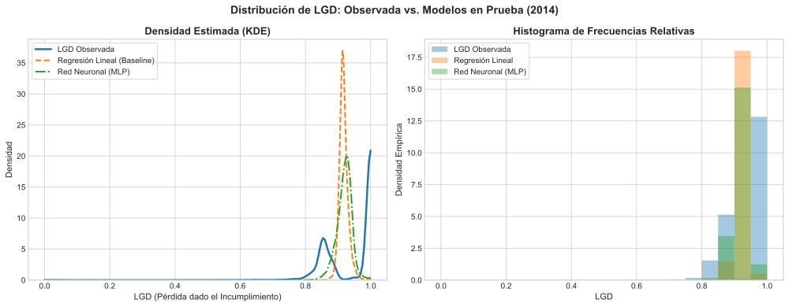
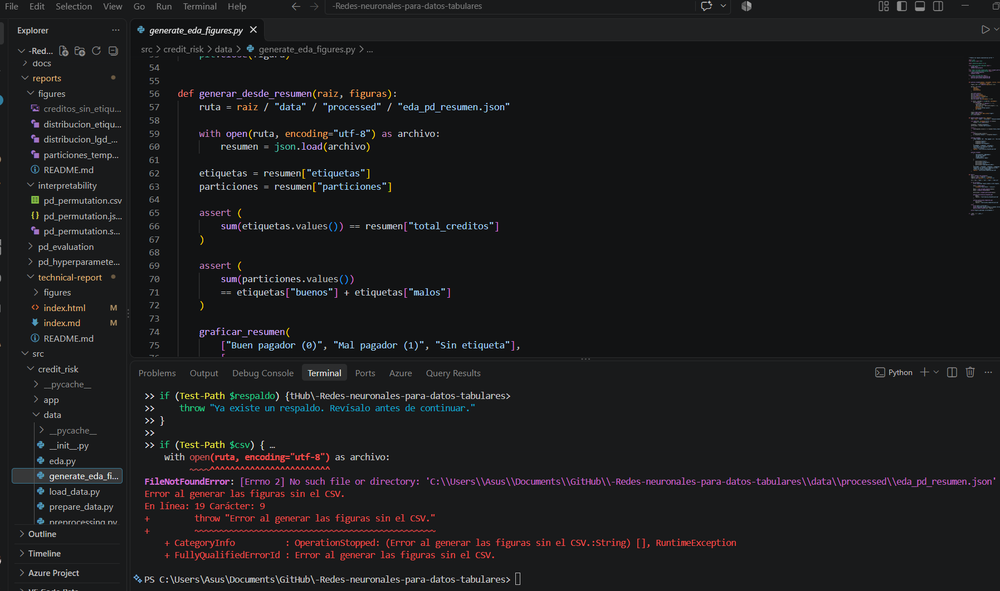

# Riesgo de crédito con redes neuronales para datos tabulares

**Reporte técnico en formato de blog · revisión de evidencia: 30 de octubre de 2026**

Este trabajo aborda dos componentes del riesgo de crédito de consumo:
estimar la probabilidad de incumplimiento (PD) y, para los préstamos que
incumplen, la pérdida dado incumplimiento (LGD). El equipo presenta una
comparación entre modelos de referencia y redes neuronales, una scorecard y
una aplicación para presentar resultados.

**Enlaces del proyecto:** [Aplicación web](https://rna-trabajo-2.streamlit.app/) ·
[Video promocional](https://youtu.be/TijgcPZNboU) ·
[Repositorio en GitHub](https://github.com/Nicorb72/-Redes-neuronales-para-datos-tabulares).

## Integrantes

1. **Nicole Guaranguay** — Datos y análisis.
2. **Nicolas Ruiz** — Clasificación: probabilidad de incumplimiento (PD).
3. **Sara Acevedo** — Regresión: pérdida dado incumplimiento (LGD).
4. **Sebastián Cataño** — Scorecard, interpretación y aplicación web.
5. **Ivan Dario Gomez Cabrera** — Integración, reproducibilidad y reporte.

## 1. Datos, caso de uso y probabilidad de incumplimiento

### 1.0 Caso de uso y alcance

Un analista de crédito evalúa una solicitud antes del desembolso. El modelo apoya comparar perfiles y estimar riesgo; no aprueba automáticamente ni fija tasas. Usa información declarada o de historial disponible entonces: monto, plazo, ingreso, empleo, vivienda y antecedentes. El solicitante puede explorar su perfil en la app. Pagos, recuperaciones y estado final construyen objetivos y evaluación; no son predictores.

La PD es $P(Y=1\mid x)$ para la etiqueta de la Tabla 1, no una tasa anual universal. El dataset es una fotografía de estados sin horizonte uniforme de desempeño. Este límite condiciona la interpretación académica del modelo.


### 1.1 Conjunto de datos y objetivo

El módulo de datos utiliza el archivo `loan.csv` del conjunto
[Credit Risk Analysis de Kaggle](https://www.kaggle.com/datasets/ranadeep/credit-risk-dataset).
El README del módulo reporta **887.379 préstamos**, originados entre junio de
2007 y diciembre de 2015. El archivo original no está incluido en GitHub por
su tamaño. El equipo descargó la copia de referencia el **24 de octubre de
2026**; al momento de la descarga no quedaron registrados el identificador de
versión ni el checksum. La integración PD–LGD regenerada registra en su JSON
el SHA-256 de la copia local usada para esa ejecución; no permite inferir por
sí sola si coincide con cada archivo empleado en experimentos históricos.
Las definiciones se toman del diccionario del proveedor (Lending Club, s. f.; Ranadeep, s. f.). El diccionario de referencia es `data/raw/LCDataDictionary.xlsx`, hoja
`LoanStats`, incluido con el dataset.

La variable `default_flag` se deriva de `loan_status`: los pagos confirmados
se codifican como 0, los incumplimientos como 1 y los estados sin resultado
definitivo quedan sin etiqueta. Estos últimos no se convierten en buenos
pagadores ni se utilizan para entrenar la clasificación de PD.

**Tabla 1. Codificación de `loan_status` para el objetivo PD.**<br>
**Fuente:** módulo de datos, `src/credit_risk/data/preprocessing.py`.

| Etiqueta | Estados de `loan_status` |
| --- | --- |
| 0 — Buen pagador | `Fully Paid`; `Does not meet the credit policy. Status:Fully Paid` |
| 1 — Mal pagador | `Charged Off`; `Default`; `Late (31-120 days)`; `Does not meet the credit policy. Status:Charged Off` |
| Sin etiqueta | `Current`; `Issued`; `In Grace Period`; `Late (16-30 days)` |

Según los conteos documentados por el módulo, hay **209.711** préstamos
etiquetados como buenos, **58.819** como malos y **618.849** sin etiqueta.
La **Figura 1** presenta esos conteos: la clase sin etiqueta es sustancial y
debe permanecer separada de las clases de entrenamiento.

<figure>
  
  <figcaption><strong>Figura 1.</strong> Conteo documentado de etiquetas para PD. <strong>Fuente:</strong> conteos registrados en <code>src/credit_risk/data/README.md</code>; figura regenerable desde el resumen versionado. Sin el CSV original no se recalculan los conteos.</figcaption>
</figure>

### 1.2 Particiones cronológicas

`asignar_particiones` conserva los préstamos con etiqueta válida y los
separa según el año de originación: entrenamiento entre 2007 y 2012,
validación en 2013, prueba en 2014 y un conjunto complementario para 2015.
La **Figura 2** compara el tamaño reportado de cada partición.

**Tabla 2. Particiones temporales reportadas para PD.**<br>
**Fuente:** módulo de datos, `src/credit_risk/data/README.md`.

| Partición | Año(s) de originación | Registros |
| --- | --- | ---: |
| Entrenamiento | 2007–2012 | 90.347 |
| Validación | 2013 | 73.194 |
| Prueba | 2014 | 74.154 |
| Complementario | 2015 | 30.835 |

<figure>
  
  <figcaption><strong>Figura 2.</strong> Tamaño de las particiones temporales reportadas para PD. <strong>Fuente:</strong> conteos registrados en <code>src/credit_risk/data/README.md</code>; figura regenerable desde el resumen versionado. Sin el CSV original no se recalculan los conteos.</figcaption>
</figure>

La partición por originación no constituye por sí sola una validación
histórica estricta: el estado final de algunos préstamos pudo conocerse
después de su fecha de originación. Además, el README del módulo reporta que
el 67,82 % del conjunto está en estado `Current` y que el 92,68 % de los
créditos originados en 2015 no tiene etiqueta. Estas observaciones limitan la
interpretación de las tasas de incumplimiento por año y pueden generar sesgo
de selección entre los préstamos etiquetados.

### 1.3 Variables y transformaciones

La implementación prepara **15 variables predictoras de entrada**:

- **Numéricas (11):** `loan_amnt`, `annual_inc`, `dti`, `delinq_2yrs`,
  `inq_last_6mths`, `open_acc`, `pub_rec`, `revol_bal`, `revol_util`,
  `total_acc` y `antiguedad_crediticia_meses`.
- **Categóricas (4):** `term`, `purpose`, `emp_length` y `home_ownership`.

La antigüedad crediticia se calcula como la diferencia en meses entre
`earliest_cr_line` y `issue_d`; valores negativos se consideran faltantes. El
preprocesamiento imputa numéricas con la mediana y las estandariza; imputa
categóricas con `Desconocido` y las codifica con one-hot encoding. El
preprocesador se ajusta **solo con entrenamiento** y luego transforma
validación, prueba y el conjunto complementario. El README del módulo reporta
44 características después de la codificación.

La revisión documentada no identificó IDs de préstamo duplicados y señala
44.825 valores faltantes en `emp_length` (5,05 %). Los valores financieros
extremos se conservan inicialmente, por lo que su efecto debe evaluarse en
los modelos. La auditoría de fuga excluye predictores evidentes de resultados
posteriores al desembolso, pero el propio módulo advierte que no verifica por
completo la disponibilidad temporal de cada variable.


### 1.4 Hipótesis derivadas del análisis descriptivo

A partir del EDA del subconjunto de **268.530 créditos etiquetados** se formularon tres hipótesis de asociación con el riesgo de incumplimiento:

**Tabla 3. Hipótesis exploratorias de riesgo.** Fuente: EDA del equipo sobre créditos etiquetados. La Tabla 3 separa descripción de contraste del modelo en la sección 5.

| Hipótesis | Fundamento descriptivo observado | Estado de la comprobación |
|---|---|---|
| **H1.** Una mayor relación deuda-ingreso (`dti`) se asocia con una mayor frecuencia de incumplimiento. | Mediana de `dti`: 18,55 en malos pagadores y 15,74 en buenos pagadores. | Compatible descriptivamente; contraste final de escenarios en la Tabla 8. |
| **H2.** Un mayor ingreso anual declarado (`annual_inc`) se asocia con menor frecuencia de incumplimiento. | Mediana de ingresos: 57.000 USD/año en malos pagadores y 64.000 USD/año en buenos pagadores. | Compatible descriptivamente; contraste final de escenarios en la Tabla 8. |
| **H3.** Un mayor monto solicitado (`loan_amnt`) se asocia con una mayor frecuencia de incumplimiento. | Mediana del préstamo: 13.000 USD en malos pagadores y 12.000 USD en buenos pagadores. | Compatible descriptivamente; contraste final de escenarios en la Tabla 8. |

Son hipótesis **exploratorias de asociación**, no causales. La sección 5 contrasta la dirección del MLP con escenarios pareados. No se interpreta importancia por permutación como dirección de efecto ni compatibilidad como demostración causal.

**Fuente:** cálculos descriptivos del módulo `src/credit_risk/data/eda.py` sobre préstamos etiquetados. Las definiciones de variables corresponden a `LCDataDictionary.xlsx`, hoja `LoanStats`.

### 1.5 Implementación y reproducción

El flujo está dividido en `load_data.py` (carga del CSV),
`preprocessing.py` (objetivo, fechas, variables y transformador),
`prepare_data.py` (particiones y matrices) y `eda.py` (resúmenes y funciones
de análisis exploratorio). El repositorio incluye las matrices PD procesadas de train, validation y test,
sus etiquetas, el preprocesador y el paquete del modelo. Por eso un clon limpio
puede ejecutar los experimentos PD y la aplicación sin descargar el CSV. Este
recorrido reproduce desde los artefactos versionados; no vuelve a construir
las matrices desde los registros originales.

Para reconstruir las matrices desde la fuente, se requiere una copia de
`loan.csv` en `data/raw/loan/loan.csv`. Desde la raíz, en PowerShell:

```powershell
$env:PYTHONPATH = "src"
python -m credit_risk.data.prepare_data
```

Este comando regenera matrices dispersas `X_*.npz`, etiquetas `y_*.npy`, el
preprocesador `pd_preprocessor.joblib` y los nombres de variables
transformadas `pd_feature_names.json`. Ajusta el preprocesador solo con train
y sobrescribe los artefactos correspondientes. La copia de referencia se
descargó el 24/10/2026, pero su identificador de versión y checksum no se
registraron; una descarga distinta podría no reconstruir exactamente los
mismos datos. Después de regenerar los datos,
se debe reentrenar PD, exportar de nuevo el paquete y validar la aplicación;
los pasos detallados están en el [README del repositorio](../../README.md).

**Estado de las figuras.** El módulo `eda.py` contiene funciones para
graficar los conteos de etiquetas y las particiones temporales. Se regeneran
con `python -m credit_risk.data.generate_eda_figures` desde la raíz. Si el CSV
está disponible, se recalculan a partir de él; si no, se usa
`data/processed/eda_pd_resumen.json` para regenerar las dos figuras principales
de PD. La ruta del resumen reproduce las figuras con los conteos registrados,
pero no recalcula esos conteos ni permite reconstruir el preprocesamiento.

### 1.6 Resultados de PD en prueba temporal

La comparación final usa la partición de prueba de 2014. La regresión
logística sirve como referencia y el MLP se ejecutó con 30 semillas
(202612–202641); por ello, los valores del MLP se presentan como media y
desviación estándar entre corridas.

La Tabla 4 resume las treinta corridas versionadas; la desviación usa $ddof=1$. Para AUC, Gini y KS mejor es máximo; para Brier y log-loss, mínimo.

<!-- BEGIN PD_METRICS -->
**Tabla 4. PD en prueba temporal 2014, treinta semillas.** Fuente: `metricas_por_semilla.csv` y `resultados.json`, derivados en [evidence.json](evidence.json).

| Métrica | Logística | MLP media ± DE | MLP mejor | MLP peor |
|---|---|---|---|---|
| AUC | 0.66476 | 0.66941 ± 0.00435 | 0.67652 | 0.66000 |
| Gini | 0.32953 | 0.33883 ± 0.00870 | 0.35303 | 0.32000 |
| KS | 0.24085 | 0.24698 ± 0.00726 | 0.25870 | 0.23390 |
| Brier | 0.18725 | 0.18180 ± 0.00096 | 0.18045 | 0.18456 |
| Log-loss | 0.56357 | 0.54471 ± 0.00267 | 0.54090 | 0.55197 |
<!-- END PD_METRICS -->

La Figura 3 muestra calibración del checkpoint y la logística; la Figura 4, discriminación; y la Figura 5, aprendizaje del checkpoint. No son curvas promedio de treinta semillas.

<figure>

<figcaption><strong>Figura 3.</strong> Calibración PD: probabilidad media frente a frecuencia observada. <strong>Fuente:</strong> evaluación versionada del equipo, <code>pd/evaluation.py</code>.</figcaption>
</figure>
<figure>

<figcaption><strong>Figura 4.</strong> ROC del modelo PD final y la logística. <strong>Fuente:</strong> evaluación versionada del equipo.</figcaption>
</figure>
<figure>

<figcaption><strong>Figura 5.</strong> Aprendizaje PD, semilla 202612. <strong>Fuente:</strong> historial versionado del entrenamiento final.</figcaption>
</figure>

El AUC medio del MLP supera al de la regresión logística en 0.00465 y su
Brier medio es 0.00545 menor; ambas diferencias favorecen al MLP, pero son
moderadas. La desviación entre semillas refleja la variabilidad de
entrenamiento en una partición fija, no un intervalo de confianza ni una
prueba de significancia. Además, la tasa de incumplimiento aumenta de 16.30 %
en entrenamiento a 26.22 % en prueba, por lo que el cambio temporal de la
población y las limitaciones de las etiquetas también deben considerarse.
Estos resultados no bastan para afirmar que la ventaja del MLP sea
estadísticamente concluyente o que se mantenga en otros periodos. La
evaluación también reporta subestimación de la tasa observada en varios
grupos de riesgo, especialmente en los de mayor PD predicha; por ello, la
discriminación debe leerse junto con la calibración.


## 2. Pérdida dado incumplimiento (LGD)

### 2.1 Objetivo y límites

Los campos del diccionario Lending Club (s. f.) permiten construir la pérdida de créditos castigados: `funded_amnt` es el capital financiado; `total_rec_prncp`, el principal recuperado previamente; `recoveries`, la recuperación posterior al castigo; y `collection_recovery_fee`, el costo de recuperación.

$$EAD_{obs,i}=\text{funded\_amnt}_i-\text{total\_rec\_prncp}_i$$

$$R_i=\text{recoveries}_i-\text{collection\_recovery\_fee}_i$$

$$LGD_i=\operatorname{clip}\left(1-\frac{R_i}{EAD_{obs,i}},0,1\right),\qquad EAD_{obs,i}>0.$$

Se usan `Charged Off` y `Does not meet the credit policy. Status:Charged Off`; se excluyen `Default`, moras cuyo proceso de recuperación no terminó y exposiciones no positivas. Esta pérdida sobre principal no descuenta flujos ni incluye todos los intereses, costos o tiempos de cobranza. Las recuperaciones pueden seguir incompletas. No se presenta como LGD regulatoria definitiva (Basel Committee on Banking Supervision, 2005).

### 2.2 Comparación y evidencia

Los modelos usan las mismas matrices: train 2007–2012 (14.419 filas), validación 2013 (14.836) y prueba 2014 (13.981). El baseline es regresión lineal recortada a $[0,1]$. El MLP usa 44 entradas, capas de 64 y 32 unidades, BatchNorm, ReLU, dropout de 0,20 y salida sigmoide.

El benchmark se repitió con cinco configuraciones y **30 semillas independientes** (101–3030, paso 101). Se seleccionó la arquitectura por RMSE de validación y, después, la semilla por ese mismo criterio. El checkpoint final es la **semilla 808**, con RMSE de validación **0.093988**. Todas las corridas se entrenan y valoran en validación antes de consultar prueba; los empates exactos se resuelven por la primera semilla del orden fijado. El JSON conserva métricas de cada corrida, la marca de selección y `test_used_for_selection=false`.

La Tabla 5 presenta esta ejecución completa. Sustituye el archivo anterior de cinco semillas. La corrección evita usar el ranking de prueba para escoger el checkpoint, pero no convierte la prueba 2014 ya consultada históricamente en un conjunto externo nuevo.

<!-- BEGIN LGD_METRICS -->
**Tabla 5. Resultados LGD respaldados por el JSON versionado.** Fuente: [lgd_benchmark_results.json](../../artifacts/models/lgd_benchmark_results.json). La DE corresponde a las corridas registradas en ese JSON.

| Modelo | Parámetros | MAE media ± DE | MAE mín–máx | RMSE media ± DE | RMSE mín–máx |
|---|---|---|---|---|---|
| Lineal recortado | 45 | 0.07711 | — | 0.08677 | — |
| MLP (30 semillas) | 5185 | 0.07714 ± 0.00074 | 0.07566–0.07910 | 0.08876 ± 0.00070 | 0.08757–0.09062 |
<!-- END LGD_METRICS -->

### 2.3 Distribución y aporte de la red

La Figura 6 se regeneró con el checkpoint seleccionado por validación y las predicciones del baseline sobre prueba 2014. Las predicciones se concentran cerca de la media y no reproducen toda la masa observada en uno. Una media condicional no tiene por qué reproducir la distribución marginal de la respuesta: son objetivos distintos.

<figure>

<figcaption><strong>Figura 6.</strong> Distribución LGD en prueba 2014, observada frente a baseline y MLP. <strong>Fuente:</strong> benchmark de 30 semillas, <code>lgd/experiments.py</code>; checkpoint 808 seleccionado por validación.</figcaption>
</figure>

Las treinta corridas presentan una diferencia pequeña de MAE y RMSE medio mayor que el baseline (Tabla 5). No muestran una ventaja clara del MLP para esta definición de LGD. La mayor complejidad no justifica afirmar superioridad universal.

### 2.4 Pérdida esperada

La relación de riesgo es $E[L_i\mid x_i]\approx PD_i\,LGD_i\,EAD_i$, con LGD condicionada al incumplimiento (Basel Committee on Banking Supervision, 2005). Requiere horizonte y exposición compatibles; multiplicar medias de LGD y EAD aleatorias exige una aproximación adicional si son dependientes.

Se usa `funded_amnt` como exposición en originación; $EAD_{obs}$ construye la etiqueta histórica de LGD. La integración por identificador aplica los modelos PD y LGD a la misma cohorte de préstamos originados en 2014 y calcula $PD_i\times LGD_i\times EAD_{0,i}$. Se puntuaron 235.628 préstamos; la PD media fue 0,22865, la LGD media predicha condicional al incumplimiento fue 0,91628 y la pérdida esperada total estimada fue USD 774.349.671,31.

En las 68.694 observaciones con resultado resuelto (29,15 %), la pérdida esperada sumó USD 208.561.086,83 y la pérdida realizada estimada, USD 168.195.585,76. Estas cantidades no son directamente comparables: la primera usa exposición en originación y la segunda el principal pendiente al castigo. Además, el objetivo PD se deriva de estados observados sin un horizonte fijo. Por tanto, la integración es exploratoria y no constituye una provisión regulatoria ni una estimación validada para un horizonte contractual. Las predicciones por préstamo y el resumen están en [`reports/lgd_evaluation/`](../lgd_evaluation/); el JSON identifica con SHA-256 la copia de `loan.csv` usada para generarlos.

### 2.5 Reproducción

Con las matrices guardadas: `python -m credit_risk.lgd.experiments --demo`; para benchmark: `python -m credit_risk.lgd.experiments --seeds 30`. La integración PD–LGD por ID se reproduce con `python -m credit_risk.lgd.portfolio --year 2014` y requiere `loan.csv`. Los parámetros de entrenamiento se pueden cambiar desde `configs/lgd_mlp_best.yaml` o por CLI. Por ejemplo:

```console
python -m credit_risk.lgd.experiments --demo --epochs 20 --patience 5 --batch-size 256 --weight-decay 0.0005
```

La demo usa 15 épocas por defecto, definidas en `demo.epochs`; `--epochs` cambia ese máximo. Paciencia, tamaño de lote y weight decay también se propagan a la búsqueda de arquitecturas y al entrenamiento final. La red usa la paciencia para early stopping, el tamaño de lote en el `DataLoader` y el decaimiento de pesos en AdamW. Solo reconstruir datos requiere `loan.csv` y `python -m credit_risk.lgd.data`. Demo guarda salidas separadas.


## 3. Scorecard, interpretación y aplicación

### 3.1 Escala de scorecard

La scorecard transforma la probabilidad de incumplimiento
$p=P(default\_flag=1 \mid x)$ a una escala de puntos. Se definen las odds
buenas:malas como $O=(1-p)/p$ y se usa una transformación logarítmica
$S=A+B\ln(O)$. Para que duplicar las odds buenas:malas sume los puntos
definidos (PDO), $B=PDO/\ln(2)$; si $S_0$ es el puntaje para odds de
referencia $O_0$, entonces $A=S_0-B\ln(O_0)$. Equivalente:

$$S(p)=S_0+\frac{PDO}{\ln 2}
\left[\ln(1-p)-\ln(p)-\ln(O_0)\right]$$

La configuración inicial usa $S_0=600$, $O_0=50:1$ y $PDO=20$; son
parámetros de escala, no resultados del modelo. Un puntaje alto representa
menor PD. Para que el puntaje y percentil sean válidos en los extremos, la
implementación recorta la probabilidad solo durante la transformación de
scorecard y usa `epsilon=1e-9`; la PD mostrada no se modifica.

La app compara el puntaje individual con la distribución empírica de PD de
train. El percentil es el porcentaje de puntajes de referencia menores o
iguales al consultado; no es una probabilidad de aprobación ni representa la
población actual. Los escenarios cambian una característica a la vez y
recalculan el perfil con el mismo preprocesador y modelo. La variación es una
respuesta local del modelo, no un efecto causal ni una garantía de que el
perfil sea factible.

### 3.2 Interpretabilidad

Se implementa importancia por permutación agrupada en la validación
temporal. Las columnas one-hot de cada variable categórica se permutan juntas;
la importancia es el incremento en Brier respecto del modelo sin permutar.
Esto cuantifica cuánto depende el modelo de una característica para predecir
en esa muestra, pero no indica por sí solo si un valor mayor aumenta el
riesgo (Fisher et al., 2019). La agrupación preserva columnas categóricas; la correlación sigue siendo una limitación (scikit-learn developers, s. f.). Las combinaciones fuera de distribución y la muestra usada también limitan la interpretación.

### 3.3 Contrato del modelo e integración de artefactos

La app espera las 15 variables originales de PD, un `ColumnTransformer`
ajustado en train, un clasificador con `predict_proba`, las clases `0` y `1`,
y la matriz transformada de train para construir la referencia del percentil.
`pd_bundle.json` registra metadatos y SHA-256 de los artefactos. La carga
valida la clase positiva, dimensiones, columnas y hashes; no entrena ni
descarga un modelo. El equipo debe usar solo archivos confiables al cargar
modelos serializados.

**Procedimiento documentado por el integrante 4 (PowerShell, raíz del repo):**

```powershell
$env:PYTHONPATH = "src"
python run_app.py --check
python run_app.py
```

El paquete y su manifiesto ya están versionados. `--check` verifica su
integridad y compatibilidad sin abrir el servidor. Si se regeneran los datos o
el modelo, se debe exportar de nuevo el paquete y repetir la comprobación:

```powershell
python -m credit_risk.scorecard.export --model artifacts/models/pd_mlp_final.pt --model-format pd_mlp --model-id pd_mlp_final-seed202612 --training-data "Matrices PD train 2007-2012" --reference-population "90347 creditos etiquetados de train 2007-2012"
python run_app.py --check
```

La exportación calcula los hashes del modelo, preprocesador, columnas y
matriz de referencia. Para regenerar la interpretación:

```powershell
python -m credit_risk.scorecard.interpretability --repeats 10 --max-rows 5000
```

La app se ejecuta localmente en `http://127.0.0.1:8501`; acepta `--port`,
`--config` y `--check`. También está publicada en
[rna-trabajo-2.streamlit.app](https://rna-trabajo-2.streamlit.app/). Si los
artefactos faltan o son incompatibles, muestra un error de integración en
lugar de producir predicciones ficticias. GitHub Pages publica el reporte
estático.

### 3.4 Integración y resultados reales

La app utiliza `pd_mlp_final.pt` (semilla 202612), `pd_preprocessor.joblib` y
`pd_feature_names.json`, publicados por el integrante 2. El paquete incluye
90.347 filas train para percentiles y 73.194 filas de validación con sus etiquetas.
La carga se hace sin entrenamiento y la clase positiva es incumplimiento = 1.
Las métricas de validación reproducidas coinciden con el reporte PD:
AUC ≈ 0,67306135 y Brier ≈ 0,16586667 (tolerancia absoluta 2e-6).

Como se observa en la Tabla 6 y la Figura 7, plazo, ingreso anual y
utilización rotativa presentan las mayores importancias de esta corrida.
La muestra contiene 5.000 filas de validación, semilla 42 y 10 permutaciones;
su Brier original es 0.16346065. La desviación entre permutaciones
no es un intervalo de confianza y el ranking no determina dirección ni causalidad.

**Tabla 6. Cinco mayores incrementos de Brier al permutar variables.**
Fuente: elaboración propia con el MLP final y validación temporal.

| Variable | Incremento medio de Brier | DE entre permutaciones |
|---|---:|---:|
| `term` | 0.006147 | 0.000543 |
| `annual_inc` | 0.005259 | 0.000651 |
| `revol_util` | 0.003100 | 0.000681 |
| `loan_amnt` | 0.001849 | 0.000208 |
| `open_acc` | 0.001357 | 0.000268 |

<figure>

<figcaption><strong>Figura 7.</strong> Importancia por permutación agrupada. <strong>Fuente:</strong> MLP final, muestra de 5.000 filas de validación, semilla 42 y diez repeticiones.</figcaption>
</figure>
[Tabla completa](../interpretability/pd_permutation.csv) y
[trazabilidad de la corrida](../interpretability/pd_permutation.json).


## 4. Fundamentación matemática y comparación justa

### 4.1 Neurona, MLP y activaciones

Una neurona calcula $z=w^Tx+b$ y $a=\phi(z)$. Un MLP compone capas: $h^{(0)}=x$, $z^{(l)}=W^{(l)}h^{(l-1)}+b^{(l)}$, $h^{(l)}=\phi_l(z^{(l)})$. Pesos y sesgos son parámetros entrenables; las capas ocultas permiten interacciones no lineales (Goodfellow et al., 2016, cap. 6).

La ReLU de las capas ocultas es $\phi(z)=\max(0,z)$, con derivada $1$ para $z>0$ y $0$ para $z<0$; se adopta subgradiente cero en el origen. La sigmoide es $\sigma(z)=1/(1+e^{-z})$, con $\sigma'(z)=\sigma(z)(1-\sigma(z))$. PD entrena con logits mediante `BCEWithLogitsLoss` y aplica sigmoide al predecir. LGD incorpora sigmoide en la red para restringir su media predicha a $(0,1)$.

En la búsqueda PD se evaluó también $\tanh(z)=(e^z-e^{-z})/(e^z+e^{-z})$, con derivada $1-\tanh^2(z)$. El código admite otras activaciones, pero eso no acredita su uso experimental. La selección final PD y las configuraciones LGD guardadas usan ReLU.

LGD intercala BatchNorm: $\widehat z_j=(z_j-\mu_{B,j})/\sqrt{v_{B,j}+\epsilon}$ y $a_j=\gamma_j\widehat z_j+\beta_j$. Durante entrenamiento las estadísticas son las del lote; en evaluación se usan promedios acumulados. $\gamma$ y $\beta$ son entrenables (Ioffe y Szegedy, 2015). No se ajustan con prueba.

### 4.2 Derivación probabilística de las pérdidas

**PD: Bernoulli.** Para observaciones condicionalmente independientes, $Y_i\mid x_i\sim\operatorname{Bernoulli}(p_i)$ y $p_i=\sigma(f_\theta(x_i))$:

$$\mathcal L(\theta)=\prod_{i=1}^n p_i^{y_i}(1-p_i)^{1-y_i}$$

$$-\frac1n\log\mathcal L(\theta)=-\frac1n\sum_{i=1}^n[y_i\log p_i+(1-y_i)\log(1-p_i)]$$

Maximizar verosimilitud equivale a minimizar BCE. Para un logit $z$ se calcula como $\max(z,0)-zy+\log(1+e^{-|z|})$, evitando desbordamientos numéricos. La logística usa el mismo objetivo sin regularización; el MLP añade L1. La derivación corresponde al modelo Bernoulli (Goodfellow et al., 2016).

**LGD: MSE.** Como modelo de trabajo, sea $Y_i\mid x_i\sim N(\mu_\theta(x_i),s^2)$ con varianza constante y $\mu_\theta(x)=\sigma(f_\theta(x))$:

$$-\log\mathcal L(\theta,s^2)=\frac n2\log(2\pi s^2)+\frac1{2s^2}\sum_i(y_i-\mu_i)^2.$$

Para $s^2$ fijo, minimizar esta expresión equivale a minimizar MSE, $n^{-1}\sum_i(y_i-\mu_i)^2$. La gaussiana no respeta el soporte LGD ni su masa en uno: **es una aproximación para la media**, no una descripción literal de la distribución. Además, $E[(Y-a)^2\mid x]=\operatorname{Var}(Y\mid x)+(E[Y\mid x]-a)^2$; la solución poblacional cuadrática es la media condicional incluso sin normalidad real.

**Alternativas LGD.** La BCE fraccionaria usa $-[y\log\mu+(1-y)\log(1-\mu)]$ para $y\in[0,1]$. Es quasi-verosimilitud, no una Bernoulli discreta literal; su uso para la media requiere especificación apropiada y condiciones de regularidad (Papke y Wooldridge, 1996).

Para residual $r=y-\mu$, Huber es:

$$\rho_\delta(r)=\begin{cases}r^2/2,&|r|\le\delta\\\delta(|r|-\delta/2),&|r|>\delta.\end{cases}$$

La densidad de trabajo $f(r)=Z_\delta^{-1}e^{-\rho_\delta(r)}$ tiene normalizador finito independiente de la media con soporte residual real; su NLL suma $\rho_\delta$ más una constante. No es una distribución acotada exacta de LGD. El código usa `HuberLoss` con $\delta=1$: dado que respuesta y predicción están en $[0,1]$, los residuales quedan en la región cuadrática, sin activar una cola robusta diferenciadora de MSE salvo escala (PyTorch Contributors, 2024). El MAE, disponible como alternativa pero no acreditado por las dos configuraciones guardadas, deriva de errores Laplace de escala fija: $f(r)=(2b)^{-1}e^{-|r|/b}$.

### 4.3 Retropropagación y optimizadores

La retropropagación aplica la regla de la cadena al grafo de operaciones (Goodfellow et al., 2016). Para una muestra con BCE y salida sigmoide, $\delta^{(L)}=p-y$; para MSE, $\delta^{(L)}=2(\mu-y)\mu(1-\mu)$. En una capa densa oculta sin normalización:

$$\delta^{(l)}=((W^{(l+1)})^T\delta^{(l+1)})\odot\phi_l'(z^{(l)})$$

$$\nabla_{W^{(l)}}\ell=\delta^{(l)}(h^{(l-1)})^T,\qquad\nabla_{b^{(l)}}\ell=\delta^{(l)}.$$

Los gradientes se promedian sobre el lote y se suma el gradiente de penalización. Dropout multiplica por la máscara escalada de la pasada hacia adelante. Con BatchNorm, para un canal con lote de tamaño $m$ y $u_i=\partial\ell/\partial a_i$, autograd incluye:

$$\frac{\partial\ell}{\partial z_i}=\frac{\gamma}{m\sqrt{v_B+\epsilon}}\left(m\,u_i-\sum_j u_j-\widehat z_i\sum_j u_j\widehat z_j\right).$$

Además, $\partial\ell/\partial\gamma=\sum_i u_i\widehat z_i$ y $\partial\ell/\partial\beta=\sum_i u_i$. Validación no actualiza pesos.

**NAdam de PD.** Sea $g_t$ el gradiente del objetivo con L1. PyTorch 2.5.1 calcula $m_t=\beta_1m_{t-1}+(1-\beta_1)g_t$, $v_t=\beta_2v_{t-1}+(1-\beta_2)g_t^2$ y $\widehat v_t=v_t/(1-\beta_2^t)$. Con $\psi=0{,}004$, $\mu_t=\beta_1(1-0{,}5\cdot0{,}96^{t\psi})$ y $M_t=\prod_{j=1}^t\mu_j$:

$$\overline m_t=\frac{\mu_{t+1}m_t}{1-M_{t+1}}+\frac{(1-\mu_t)g_t}{1-M_t},\qquad\theta_t=\theta_{t-1}-\eta\frac{\overline m_t}{\sqrt{\widehat v_t}+\epsilon}.$$

Las operaciones son por componente; $m_0=v_0=0$, $M_0=1$, $\beta_1=0{,}9$, $\beta_2=0{,}999$ y $\epsilon=10^{-8}$. PD usa $\eta=0{,}009872493705787$, sin weight decay en el optimizador; L1 se añade explícitamente. Las ecuaciones corresponden al código fijado (PyTorch Contributors, 2024).

**AdamW de LGD.** Para gradiente de la pérdida sin L2 y los mismos momentos, sea $\widehat m_t=m_t/(1-\beta_1^t)$:

$$\theta_t=(1-\eta\lambda)\theta_{t-1}-\eta\frac{\widehat m_t}{\sqrt{\widehat v_t}+\epsilon}.$$

LGD usa por defecto $\eta=0{,}001$ y $\lambda=10^{-4}$. El decaimiento desacoplado **no equivale en general a sumar L2 al objetivo de Adam** (Loshchilov y Hutter, 2019). En la búsqueda PD también se consideran Adam, que usa $\widehat m_t$ sin anticipación, y SGD con momento: $u_t=0{,}9u_{t-1}+g_t$, $\theta_t=\theta_{t-1}-\eta u_t$. Son alternativas; NAdam es el optimizador PD final.

### 4.4 Regularización y parámetros entrenables

PD minimiza $J=\overline\ell_{BCE}+\lambda_1\sum_{w\in W}|w|$ con $\lambda_1=4{,}133872799689977\times10^{-6}$, excluyendo sesgos. El subgradiente es $\lambda_1\operatorname{sign}(w)$ para $w\ne0$ y se adopta cero en el origen. La alternativa L2 es $\lambda_2\sum w^2/2$, con gradiente $\lambda_2w$; elastic net suma ambas.

Dropout invertido usa $\widetilde h=(r\odot h)/(1-q)$ con $r_j\sim\operatorname{Bernoulli}(1-q)$ al entrenar; en evaluación $\widetilde h=h$. PD usa $q=0{,}3326782661$ y LGD $q=0{,}20$ (Srivastava et al., 2014). Parada temprana conserva $\theta_{e^*}$ para $e^*=\arg\min_e\ell_{val}(\theta_e)$ y detiene tras ocho épocas sin mejora; PD usa tolerancia $10^{-5}$. No se usa test para elegir la época.

Para capas densas, $P=\sum_l(d_{l-1}+1)d_l$. PD tiene $45\cdot64+65\cdot64+65=7.105$ parámetros. LGD tiene $45\cdot64+65\cdot32+33=4.993$ densos más $2(64+32)=192$ de BatchNorm, total **5.185**. Sus promedios móviles no son entrenables. Los baselines tienen 44 coeficientes y un intercepto: **45** parámetros.

### 4.5 Métricas e incertidumbre

Con $n$ créditos, etiquetas $y_i$, PD $p_i$, LGD observada $l_i$ y predicción $\widehat l_i$:

- **ROC y AUC:** $TPR(c)=P(p\ge c\mid Y=1)$, $FPR(c)=P(p\ge c\mid Y=0)$; AUC integra TPR respecto a FPR. Equivale a $P(p_1>p_0)+\tfrac12P(p_1=p_0)$; mayor es mejor.
- **Gini:** $G=2AUC-1$; no es una evaluación independiente del AUC.
- **KS PD:** $KS=\max_c|TPR(c)-FPR(c)|$. El código toma $\max(TPR-FPR)$ con probabilidades orientadas a riesgo. Si la ROC cruzara de forma relevante por debajo de la diagonal, se requeriría el valor absoluto para coincidir con la definición bilateral.
- **Brier:** $BS=n^{-1}\sum_i(p_i-y_i)^2$. Menor es mejor; evalúa error probabilístico, no solo calibración.
- **Log-loss:** $-n^{-1}\sum_i[y_i\log p_i+(1-y_i)\log(1-p_i)]$. El evaluador recorta probabilidades a $[10^{-7},1-10^{-7}]$ para estabilidad.
- **Calibración:** para cada grupo $B_k$ de cuantiles se compara $\overline p_k=|B_k|^{-1}\sum_{i\in B_k}p_i$ con $\overline y_k=|B_k|^{-1}\sum_{i\in B_k}y_i$. Se muestran diez grupos, combinando empates cuando corresponde; la identidad representa concordancia.
- **MAE:** $n^{-1}\sum_i|l_i-\widehat l_i|$; **RMSE:** $\sqrt{n^{-1}\sum_i(l_i-\widehat l_i)^2}$. Menor es mejor; RMSE pondera más los errores grandes.
- **Diagnósticos LGD adicionales:** $R^2=1-\sum(l_i-\widehat l_i)^2/\sum(l_i-\overline l)^2$; Pearson es covarianza dividida por desviaciones; Spearman es Pearson de rangos. KS de dos muestras es $\sup_z|\widehat F_l(z)-\widehat F_{\widehat l}(z)|$ y Wasserstein-1 es $\int|\widehat F_l(z)-\widehat F_{\widehat l}(z)|dz$. Estos dos últimos comparan distribuciones marginales, no error por crédito.

Las implementaciones se contrastan con scikit-learn developers (2024) y SciPy developers (2024). Media y desviación entre semillas describen aleatoriedad del entrenamiento en una partición fija; no son intervalos de confianza. PD usa desviación muestral ($ddof=1$) y el JSON LGD desviación poblacional de sus corridas ($ddof=0$).

### 4.6 Presupuesto y comparación justa

Los modelos de una tarea usan las mismas matrices y particiones; la arquitectura se selecciona con validación. La Tabla 7 separa búsqueda, ajuste final y baseline. Los tiempos son los registrados por el equipo y dependen del hardware. La logística no recibió los 180 ensayos de la red: esa asimetría se declara expresamente.

<!-- BEGIN COMPUTE -->
**Tabla 7. Presupuesto y complejidad por familia.** Fuente: resumen de búsqueda PD, treinta corridas PD y JSON LGD versionados.

| Familia / fase | Configuraciones o corridas | Tiempo registrado | Parámetros finales |
|---|---|---|---|
| Logística PD | 1 ajuste | 0.065 s | 45 |
| MLP PD: búsqueda | 180 ensayos + 25 corridas de robustez | 1.994,85 s oficiales | 7.105 |
| MLP PD: evaluación final | 30 semillas de una configuración | 137.51 s de ajuste | 7.105 |
| Lineal LGD | 1 ajuste | 0.040 s | 45 |
| MLP LGD: archivo guardado | 5 configuraciones + 30 semillas | 31.98 s búsqueda + 165.07 s ajustes | 5185 |
<!-- END COMPUTE -->

El presupuesto oficial PD incluye 150 ensayos iniciales y 30 de refinamiento, más 25 corridas de robustez de candidatos. El resumen registra 1.994,85 s oficiales y 705,82 s de exploración descartada, total 2.700,67 s; se separan de los 30 ajustes finales. Para LGD, la sección 2.2 documenta cinco configuraciones y treinta corridas; el JSON incluye la selección por validación y todas las métricas por semilla.

## 5. Cierre de hipótesis, discusión y aprendizajes

### 5.1 Contraste con el modelo

Se ejecutó **solo inferencia** del checkpoint PD final sobre 5.000 filas de validación 2013, seleccionadas sin reemplazo con `default_rng(42)`. Para cada variable de la Tabla 3 se crean dos copias del mismo perfil: se sustituye únicamente su valor por P25 y P75 de toda la validación y se mantienen las demás variables fijas. Los cuartiles se calculan tras imputación y se convierten a unidades originales con el escalador guardado. Muestra, hashes y resultados quedan en [evidence.json](evidence.json), regenerable con `python scripts/report_evidence.py`.

La Tabla 8 cierra las tres hipótesis: todas son compatibles con las medianas descriptivas y la dirección **media** de los escenarios del MLP. No son leyes monotónicas para toda persona; DTI presenta respuestas individuales de distinto signo. Los coeficientes de la logística coinciden en dirección, como asociación condicionada al modelo, no como causalidad.

<!-- BEGIN HYPOTHESES -->
**Tabla 8. Contraste de hipótesis mediante escenarios pareados P25→P75.** Fuente: inferencia nueva del checkpoint final, validación 2013, 5.000 filas, semilla 42; [evidence.json](evidence.json). Cambio PD en puntos porcentuales; coeficiente logístico por unidad estandarizada.

| Hipótesis | Valores en unidades originales | Cambio medio PD (pp) | Coeficiente logístico | Conclusión acotada |
|---|---|---|---|---|
| H1: `dti` | 11.21 → 22.50 | +0.963 | +0.0545 | Compatible: PD media mayor; no causal |
| H2: `annual_inc` | 46,000.00 → 89,000.00 | -5.656 | -0.4213 | Compatible: PD media menor; no causal |
| H3: `loan_amnt` | 8,325.00 → 20,000.00 | +4.236 | +0.1488 | Compatible: PD media mayor; no causal |
<!-- END HYPOTHESES -->

Las correlaciones pueden producir perfiles poco plausibles al cambiar una variable aislada. Las conclusiones se limitan al modelo, muestra y cuartiles descritos, sin intervalos de incertidumbre ni pruebas estadísticas de confirmación. La permutación de la Tabla 6 mide dependencia predictiva; los escenarios de la Tabla 8 miden dirección de respuesta en una comparación definida. No son medidas intercambiables.

### 5.2 Qué aportaron las redes

PD muestra mejora media moderada frente a la logística: AUC +0,00465 y Brier −0,00545 en prueba 2014. Debe leerse junto con variación entre semillas, mayor presupuesto y desplazamiento temporal de la tasa de incumplimiento. No demuestra superioridad general ni calibración adecuada para decisiones reales. En LGD, las treinta corridas guardadas no muestran una ventaja clara del MLP frente al baseline; el checkpoint se seleccionó exclusivamente por validación.

La logística permite interpretar log-odds directamente. El MLP representa no linealidades, pero necesita herramientas adicionales y cautela con correlaciones. Convertir PD en puntaje facilita la comunicación; no mejora por sí solo las probabilidades.

### 5.3 Aprendizajes

1. La etiqueta y su horizonte importan tanto como la arquitectura: los préstamos sin resultado final no son buenos pagadores confirmados.
2. La separación temporal y el preprocesamiento ajustado solo en train reducen fugas, pero no resuelven toda la madurez desigual de etiquetas.
3. Mayor AUC no garantiza calibración: Brier y curvas aportan información adicional.
4. Más parámetros y ensayos no implican mejora útil; costo y variabilidad son parte de la comparación.
5. Importancia, asociación y causalidad son preguntas distintas; un escenario no garantiza reducir el impago real.
6. Código, datos, modelos y narrativa forman una entrega: una demo no debe presentarse como benchmark completo.
7. Las recomendaciones de IA requieren comprobación matemática, bibliográfica y en un clon limpio.

## 6. Reproducción y ejecución

Instalar el entorno del [README](../../README.md) y ejecutar desde la raíz. Los artefactos versionados no requieren `loan.csv`:

```powershell
$env:PYTHONPATH = "src"
python -m credit_risk.data.generate_eda_figures
python -m credit_risk.pd.experiments --demo
python -m credit_risk.lgd.experiments --demo
python run_app.py --check
python -m pytest -q
python run_app.py
```

En una revisión previa del 30/10/2026, en una extracción limpia de main sin CSV y con el entorno existente, PD demo tardó 30,16 s, LGD demo 71,88 s, el paquete pasó `--check` y hubo 60 pruebas aprobadas y una omitida. En la verificación posterior a la integración PD–LGD, la suite registró 70 pruebas aprobadas; el reporte pasó `scripts/build_report.py --check` y la cohorte 2014 se regeneró desde el CSV identificado en su JSON. Son mediciones de esa máquina, no una instalación independiente ni garantías universales. La prueba integral en otra computadora sigue siendo parte del cierre.

Los benchmarks se ejecutan con `python -m credit_risk.pd.experiments` y `python -m credit_risk.lgd.experiments --seeds 30`. Reentrenar PD exige exportar de nuevo el paquete según el README. Reconstruir matrices desde el original requiere CSV y los comandos `credit_risk.data.prepare_data` y `credit_risk.lgd.data`.

Scorecard usa `configs/default.yaml` y PD usa `configs/pd_mlp_best.yaml`. Para LGD, paciencia, tamaño de lote y weight decay están disponibles en YAML y CLI y se propagan a la búsqueda y al entrenamiento final. La demo utiliza 15 épocas por defecto, no de forma fija: `--epochs` permite cambiar el máximo. Las pruebas unitarias cubren la resolución de épocas y la propagación de los parámetros.

**Construcción del blog.** El Markdown es la fuente única; no editar HTML manualmente. El [README del reporte](README.md) explica cómo instalar `requirements-report.txt`, actualizar evidencia de inferencia sin entrenamiento y construir/verificar el HTML. `--check` detecta tablas derivadas o HTML desactualizados y referencias locales rotas.


## 7. Uso de inteligencia artificial

ChatGPT/Codex apoyó la estructura de código y documentación, integración de artefactos, revisión de fórmulas y diagnóstico de reproducibilidad. La IA no es la fuente del significado de variables ni de resultados experimentales: estos se contrastan con diccionario, código y archivos guardados. El equipo conserva la responsabilidad sobre decisiones y defensa.

La Tabla 9 reúne instrucciones disponibles en el registro de trabajo. No se reconstruyen como literales los prompts cuyo archivo original falta. La sección 8 conserva los casos y sus límites de procedencia.

**Tabla 9. Prompts conservados y efecto en la entrega.** Fuente: conversación de trabajo y casos documentados por el equipo. La Tabla 9 distingue solicitud y comprobación.

| Prompt disponible | Impacto | Verificación |
|---|---|---|
| «Implementa scorecard configurable (puntaje base, odds, PDO, derivación y pruebas), interpretabilidad del modelo PD con metodología justificable, y aplicación web que muestre PD, puntaje, percentil y simulación de cambios.» | Estructuró puntajes e integración de inferencia. | Derivación, pruebas y checkpoint real, sin inventar resultados. |
| «Actualiza los resultados de los markdown y las descripciones del notebook para que sean consistentes con los nuevos resultados que dio el codigo» | Solicitó sincronizar búsqueda y narrativa. | Contraste con JSON/CSV; conservar diffs para demostrar el error previo. |
| «Chat haz una evaluación general del proyecto con lo que nos pidieron en el documento, dime lo que falta y lo que está completo» | Motivó cotejo con PDF, código y pruebas. | Detectó discrepancia LGD cinco/treinta semillas y límites de reproducción. |
| «Chat puedes arreglar el 4 por favor» | Solicitó completar el reporte tras esa evaluación. | Fuente única Markdown, tablas desde evidencia y escenarios sin reentrenar. |

**Impacto y límites.** La asistencia aceleró implementación y redacción, pero exigió revisar afirmaciones demasiado seguras. Se detectaron menciones de publicación pendiente después de publicar, diferencias Markdown/HTML y resultados LGD sin respaldo consistente. Esta edición mantiene los pendientes reales. Los escenarios agregados son inferencia nueva declarada, no resultados históricos reconstruidos ni nueva selección usando prueba.

## 8. Cacería de la alucinación

### 8.1 Registro y procedencia

La Tabla 10 resume los cinco hallazgos declarados en [docs/caceria_alucinaciones.md](../../docs/caceria_alucinaciones.md), cubriendo cinco categorías. El documento incluye prompt, respuesta, sospecha, evidencia, corrección y lección. Esos apartados no certifican por sí solos la autenticidad de una conversación: se deben conservar registros originales y comprobaciones. Los casos de evidencia parcial se identifican; no se fabrican episodios.

**Tabla 10. Hallazgos declarados y verificación requerida.** Fuente: documento de cacería y archivos del proyecto. La Tabla 10 es un índice de evidencia, no una certificación independiente de los episodios.

| Caso | Categoría | Error reportado y corrección | Evidencia y límite |
|---|---|---|---|
| H1 | Datos del mundo real | Usar predictores posteriores al desembolso o confundir exposiciones. Separar entradas ex-ante y campos del objetivo. | Diccionario y objetivo LGD; conservar respuesta original. |
| H2 | Matemáticas | Restringir sigmoide a clasificación o proponer softmax escalar. Justificar media acotada y pérdidas. | Sección 4 y pruebas de rango; conservar respuesta original. |
| H3 | Código | Ajustar transformador antes de separar particiones. Ajustar solo con train. | Código de preparación. El PDF exige una partición temporal justificada; **no fija** los años 2007–2012/2013/2014 elegidos por el equipo. El error del resumen EDA se documenta en 8.2. |
| H4 | Bibliografía | Referencias o DOI mal atribuidos por IA. Contrastar título, autor y fuente primaria. | Conservar registros y consultas DOI; declarar verificación no basta. |
| H5 | Conceptos | Afirmar superioridad universal del MLP. Comparar con baseline y costos. | Tablas 4 y 5; benchmark LGD de treinta semillas con registros por corrida y selección por validación. |

Las secciones 8.2–8.4 preservan relatos anteriores y explicitan la evidencia faltante. El enunciado permite presentar verificaciones cuando no hay cinco hallazgos genuinos; no corresponde completarlos con casos inventados.


### 8.2 Caso documentado: fallo de reproducibilidad en la generación de figuras del EDA

**Categoría:** Código y reproducibilidad.

**Contexto**

Cuando terminé las figuras del análisis exploratorio de Lending Club, el generador funcionaba en mi computador porque allí tenía `loan.csv`. Sin embargo, ese archivo estaba excluido de GitHub por su tamaño. Al pensar en la entrega, me di cuenta de que alguien que clonara el repositorio no podría ejecutar el mismo proceso sin conseguir primero el CSV.

**Prompt presentado para el caso (versión revisada)**

> Estoy trabajando en las gráficas del análisis exploratorio de Lending Club. En mi computador funcionan, pero al clonar el repositorio en otro equipo presentan errores porque necesitan `loan.csv`, que no está en GitHub por su tamaño.
>
> ¿Cómo puedo modificar el código para generar las gráficas sin depender del CSV original y comprobar que funciona en un clon limpio?

**Respuesta de la IA (fragmentos relevantes de la conversación)**

ChatGPT propuso generar las figuras desde un archivo pequeño de estadísticas, `data/processed/eda_pd_resumen.json`, cuando `loan.csv` no estuviera disponible, y recomendó ejecutar:

```powershell
$env:PYTHONPATH = "src"
python -m credit_risk.data.generate_eda_figures
```

En el código alternativo, la función intentaba abrir directamente el resumen:

```python
ruta = raiz / "data" / "processed" / "eda_pd_resumen.json"
with open(ruta, encoding="utf-8") as archivo:
    resumen = json.load(archivo)
```

La respuesta también había indicado crear ese JSON y añadir una excepción a `.gitignore`. El fallo ocurrió porque la nueva ruta de ejecución dependía de que ese archivo ya estuviera creado y disponible; el código no comprobaba su existencia ni daba una indicación útil para recuperarlo.

**Error encontrado y evidencia**

Para comprobar la ejecución sin el CSV, lo oculté temporalmente y ejecuté el generador. El programa se detuvo con:

```text
FileNotFoundError: [Errno 2] No such file or directory:
...\data\processed\eda_pd_resumen.json
Error al generar las figuras sin el CSV.
```

El problema no era el cálculo de los conteos, sino una dependencia necesaria para la alternativa propuesta que no estaba disponible en el entorno de prueba. La solución de IA no había quedado lista para ejecutarse tal como estaba en ese momento.

Como muestra la Figura 8, falta un artefacto requerido.

<figure>

<figcaption><strong>Figura 8.</strong> Fallo sin CSV ni resumen EDA. <strong>Fuente:</strong> captura aportada por el equipo.</figcaption>
</figure>

**Corrección técnica**

La corrección consiste en crear y versionar `data/processed/eda_pd_resumen.json` con las estadísticas ya verificadas del dataset y permitir su inclusión en Git mediante una excepción en `.gitignore`. Los datos esenciales son:

```json
{
  "total_creditos": 887379,
  "etiquetas": {"buenos": 209711, "malos": 58819, "sin_etiqueta": 618849},
  "particiones": {"train": 90347, "validation": 73194, "test": 74154, "supplementary_2015": 30835}
}
```

La generación desde el resumen permite reconstruir las **dos figuras principales de PD** sin el CSV, mientras que repetir el preprocesamiento completo continúa requiriendo `loan.csv`. Es importante conservar la ruta y los nombres del JSON en sincronía con el generador.

Se creó el archivo con estos valores y se actualizó `.gitignore`. Después se
ejecutó el comando recomendado en el clon disponible, donde no están ni el CSV
ni el resumen antes de aplicar la corrección: la ejecución inicial falló como
se documenta arriba. Con el resumen versionado, el mismo comando generó las dos
figuras correctamente. La prueba automatizada también comprueba esa ruta
alternativa. Esto verifica la regeneración de las figuras con los conteos
registrados, pero no permite recalcularlos ni sustituye el CSV para repetir el
preprocesamiento completo.

**Resultado y aprendizaje**

La prueba documentada evidenció un fallo real de integración de la recomendación de ChatGPT: el mecanismo alternativo intentaba leer un archivo inexistente. La causa se corrigió al versionar el resumen y permitir su inclusión en Git; el comando y la prueba automatizada verifican que las figuras se generen sin el CSV. No se trata de una cifra inventada por la IA, sino de una **solución de código incompleta respecto a sus dependencias**, que solo se hizo evidente al probarla sin el archivo original. Este caso muestra por qué las recomendaciones de código también deben verificarse en el entorno real de entrega.

---


### 8.3 Caso reportado: evaluación de PD incompleta por omitir la calibración

**Categoría:** Código y métricas.

**Prompt utilizado (literal)**

El prompt literal se indicó como un archivo adjunto compartido durante la
conversación, pero ese archivo no está disponible entre los materiales del
repositorio revisados para esta edición. Por tanto, no se reconstruye ni se
presenta una paráfrasis como si fuera la instrucción literal. Debe incorporarse
aquí el texto del archivo para que el registro cumpla este requisito del
enunciado.

**Respuesta de la IA (parte relevante)**

Al solicitarle construir el flujo de optimización y evaluación de
hiperparámetros para el modelo de probabilidad de incumplimiento (PD), la IA
entregó el código sin incluir la evaluación de calibración mediante el puntaje
de Brier y la curva de calibración. La omisión se detectó al revisar el código
y el alcance de la evaluación solicitada. No se conserva aquí una cita textual
de la respuesta original.

**Cómo se sospechó y evidencia**

La evaluación de un modelo de PD debe permitir examinar tanto la discriminación
como la calidad de las probabilidades estimadas. La revisión del flujo mostró
que faltaban el Brier y el diagnóstico gráfico de calibración; por eso se
implementaron después. En el estado actual del repositorio,
`src/credit_risk/pd/evaluation.py` calcula el Brier y construye la curva de
calibración, mientras `src/credit_risk/pd/experiments.py` guarda la tabla por
grupos y genera el gráfico. El informe de evaluación documenta la fórmula del
Brier y la interpretación de la curva en
`reports/pd_evaluation/informe_pd.md`.

Esta evidencia permite verificar la corrección incorporada, pero el prompt y
la respuesta literal originales no están adjuntos aquí; para presentar este
hallazgo como una auditoría plenamente reproducible hay que conservarlos junto
con el resultado de la revisión inicial.

**Corrección**

Se añadieron el cálculo del puntaje de Brier y la curva de calibración a la
evaluación de PD, y se reportan junto con AUC, Gini, KS y log-loss. La curva
permite comparar, por grupos de riesgo, la PD media predicha con la tasa de
incumplimiento observada. La prueba final reporta que ambos modelos subestiman
la tasa observada en varios grupos; por ello, el AUC por sí solo no describe
la calidad de las probabilidades.

**Lección aprendida**

La revisión del código debe incluir la inspección sistemática de los
elementos generados y una lista de verificación con los criterios esenciales
para evaluar la implementación y la información reportada. Este procedimiento
permite comprobar que el código cumple los requisitos del análisis y que los
resultados presentados son coherentes y están respaldados por las métricas y
los artefactos correspondientes.

### 8.4 Caso reportado: resultados actualizados sin revisar las descripciones de las fases

**Categoría:** Código y reproducibilidad documental.

**Prompt utilizado (literal)**

> Actualiza los resultados de los markdown y las descripciones del notebook para que sean consistentes con los nuevos resultados que dio el codigo

**Respuesta de la IA (parte relevante)**

Al cambiar el número de ensayos de las fases de optimización, la IA actualizó
los resultados en los Markdown, pero dejó sin actualizar la descripción de
las fases. Así, las cifras nuevas y la explicación del procedimiento quedaron
desincronizadas: quien lee el informe podía entender que se había ejecutado
una búsqueda distinta de la que realmente produjo los resultados.

**Cómo se sospechó y evidencia**

La discrepancia se identificó al contrastar los conteos nuevos de ensayos con las
descripciones de las fases. El resumen versionado de la búsqueda actual
(`reports/pd_hyperparameter_search/resumen_optimizacion.json`) registra 150
ensayos en la primera fase y 30 en la segunda (180 exitosos); el informe de
PD también describe 150 y 30 ensayos. El caso reportado por el equipo es que,
tras modificar esos conteos, se actualizaron los resultados pero no las
descripciones correspondientes. Para documentar la versión previa y la nueva
hace falta conservar ambas versiones de los Markdown/notebook o un diff; el
estado actual por sí solo no permite reconstruir qué texto quedó desactualizado
ni durante cuánto tiempo.

**Corrección**

Se actualizaron conjuntamente los conteos, resultados y descripciones: el
notebook ahora indica 150 ensayos iniciales y 30 de refinamiento, en
concordancia con el JSON de búsqueda y el informe PD. Los mejores AUC de
validación fueron 0.67338 y 0.67471, respectivamente. El texto histórico
desactualizado no se puede reconstruir sin la versión previa o un diff.

**Lección aprendida**

Cuando cambian los experimentos, actualizar resultados y narrativa como una
sola revisión. Antes de entregar, contrastar el notebook y los Markdown con el
resumen de ejecución versionado y revisar que cada descripción de fase
corresponda a los ensayos realmente ejecutados. Guardar el diff o la
conversación original facilita demostrar el error y su corrección.


## 9. Referencias

Las fuentes se citan junto a los métodos que sustentan; los resultados propios remiten a archivos del repositorio. Las entradas siguen orden alfabético y formato APA 7. Las definiciones de negocio proceden del diccionario distribuido con el dataset.

- Basel Committee on Banking Supervision. (2005). *An explanatory note on the Basel II IRB risk weight functions*. Bank for International Settlements. <https://www.bis.org/bcbs/irbriskweight.pdf>
- Fisher, A., Rudin, C., & Dominici, F. (2019). All models are wrong, but many are useful: Learning a variable’s importance by studying an entire class of prediction models simultaneously. *Journal of Machine Learning Research, 20*(177), 1–81. <https://www.jmlr.org/papers/v20/18-760.html>
- Goodfellow, I., Bengio, Y., & Courville, A. (2016). *Deep learning*. MIT Press. <https://www.deeplearningbook.org/>
- Ioffe, S., & Szegedy, C. (2015). Batch normalization: Accelerating deep network training by reducing internal covariate shift. En *Proceedings of the 32nd International Conference on Machine Learning* (Vol. 37, pp. 448–456). PMLR. <https://proceedings.mlr.press/v37/ioffe15.html>
- Lending Club. (s. f.). *LCDataDictionary* [Diccionario de datos, hoja LoanStats]. Distribuido con el conjunto Credit Risk Analysis de Ranadeep. <https://www.kaggle.com/datasets/ranadeep/credit-risk-dataset>
- Loshchilov, I., & Hutter, F. (2019). Decoupled weight decay regularization. En *International Conference on Learning Representations*. <https://arxiv.org/abs/1711.05101>
- Papke, L. E., & Wooldridge, J. M. (1996). Econometric methods for fractional response variables with an application to 401(k) plan participation rates. *Journal of Applied Econometrics, 11*(6), 619–632. [https://doi.org/10.1002/(SICI)1099-1255(199611)11:6&lt;619::AID-JAE418&gt;3.0.CO;2-1](https://doi.org/10.1002/%28SICI%291099-1255%28199611%2911%3A6%3C619%3A%3AAID-JAE418%3E3.0.CO%3B2-1)
- PyTorch Contributors. (2024). *PyTorch* (versión 2.5.1) [Código fuente]. [NAdam](https://github.com/pytorch/pytorch/blob/v2.5.1/torch/optim/nadam.py), [AdamW](https://github.com/pytorch/pytorch/blob/v2.5.1/torch/optim/adamw.py) y [funciones de pérdida](https://github.com/pytorch/pytorch/blob/v2.5.1/torch/nn/modules/loss.py).
- Ranadeep. (s. f.). *Credit risk analysis* [Conjunto de datos]. Kaggle. <https://www.kaggle.com/datasets/ranadeep/credit-risk-dataset>
- scikit-learn developers. (2024). *Model evaluation: Quantifying the quality of predictions* (versión 1.5) [Documentación]. <https://scikit-learn.org/1.5/modules/model_evaluation.html>
- scikit-learn developers. (s. f.). *Permutation importance with multicollinear or correlated features* (versión 1.5) [Documentación]. <https://scikit-learn.org/1.5/auto_examples/inspection/plot_permutation_importance_multicollinear.html>
- SciPy developers. (2024). *Statistical functions* (versión 1.14.1) [Documentación]. <https://docs.scipy.org/doc/scipy-1.14.1/reference/stats.html>
- Srivastava, N., Hinton, G., Krizhevsky, A., Sutskever, I., & Salakhutdinov, R. (2014). Dropout: A simple way to prevent neural networks from overfitting. *Journal of Machine Learning Research, 15*(56), 1929–1958. <https://www.jmlr.org/papers/v15/srivastava14a.html>
